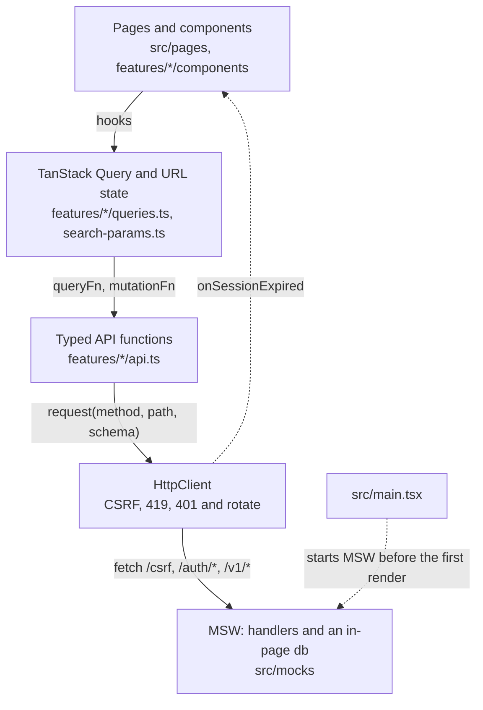
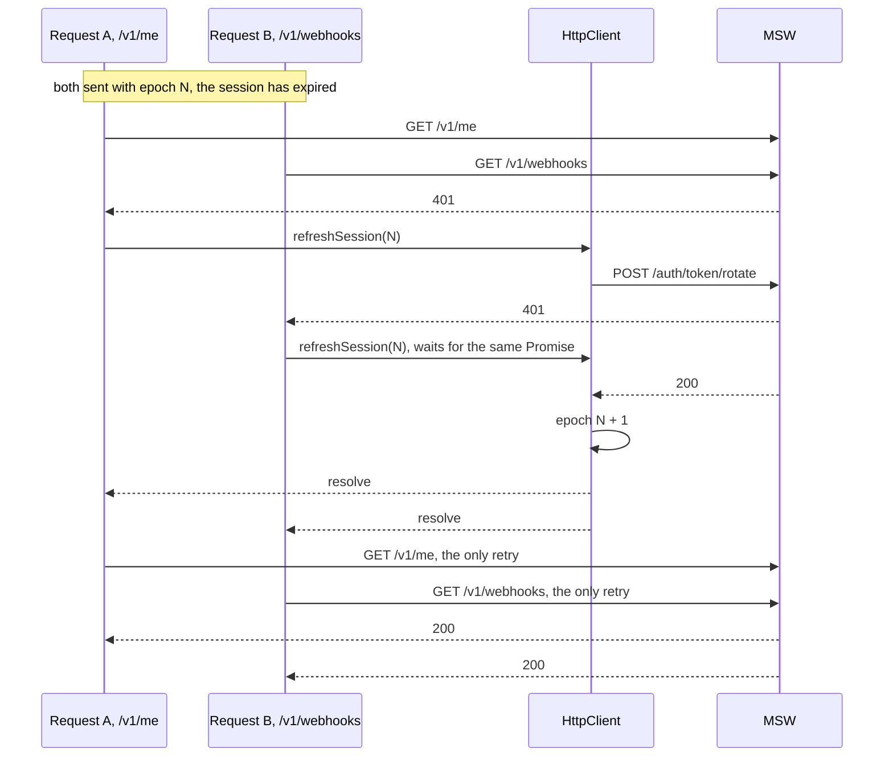
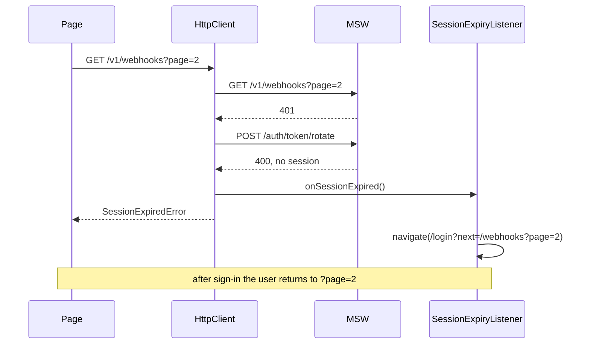
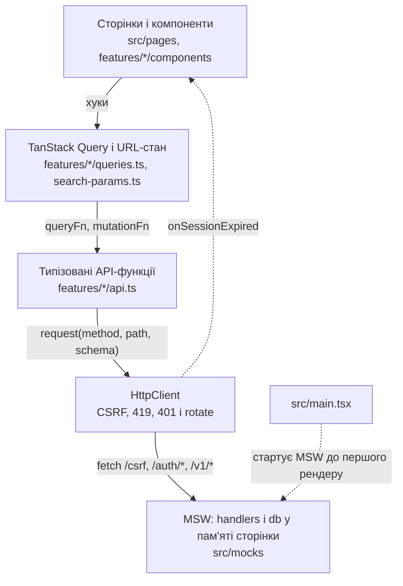
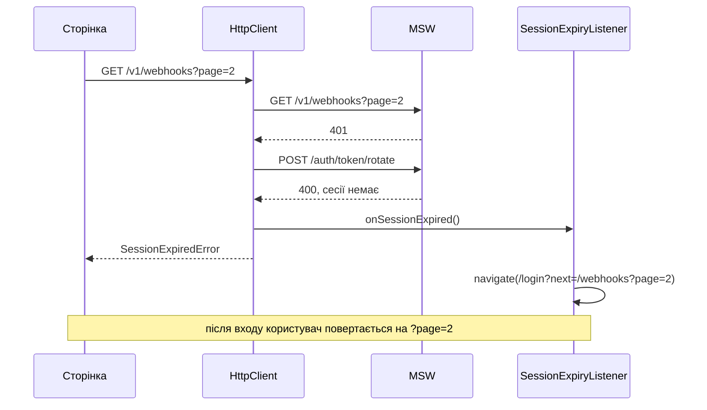

<a id="english"></a>

# Smart Sender: webhooks

> **Українська версія — [нижче](#ukrainian).**

A Senior Frontend Engineer test task. The app has a sign-in with a rotating session, a webhook list with search and pagination kept in the URL, and an edit page with server-side validation. The backend is an MSW mock that follows the contract from the task.

**Stack:** React 19 + Vite 8 (SPA), React Router 7, TypeScript (strict), TanStack Query 5, react-hook-form + zod 4, shadcn/ui (Base UI), MSW 3, Vitest 5.

## Getting started

You need Node.js 22.12+ and pnpm 11. The pnpm version is pinned in `packageManager`, so `corepack enable` picks it up automatically.

```bash
pnpm install --frozen-lockfile
pnpm dev
```

The app opens at http://localhost:5173. If the port is taken, Vite picks the next free one and prints the address in the terminal.

Tests:

```bash
pnpm test
```

| Script                             | What it does                                                         |
| ---------------------------------- | -------------------------------------------------------------------- |
| `pnpm dev`                         | Vite dev server                                                      |
| `pnpm build`, `pnpm preview`       | production build and a local preview of it                           |
| `pnpm test`, `pnpm test:watch`     | Vitest: `HttpClient` against the real mock handlers, URL state rules |
| `pnpm typecheck`                   | `tsc --noEmit`                                                       |
| `pnpm lint`                        | ESLint                                                               |
| `pnpm format`, `pnpm format:check` | Prettier                                                             |

### Demo account

| Field    | Value                   |
| -------- | ----------------------- |
| Email    | `demo@smartsender.test` |
| Password | `Demo1234!`             |

The mock lives in the page's memory, so a reload drops the session and you sign in again (the task allows this). After sign-in the app returns to the same address, so the list params from the URL still apply.

The mock runs through a Service Worker, so open the app on `http://localhost` (or over HTTPS). If the Service Worker API is missing (for example, in a private Firefox window), MSW intercepts requests inside the page instead.

## What is implemented

- **Sign-in.** An email and password form, then `POST /auth/login` → `POST /auth/token/issue` → `GET /v1/me` → the webhook list.
- **`device_session_token`** exists only as a local variable inside the sign-in function. It never reaches React state, the query cache, storage or the URL.
- **`fingerprint`.** 32 hex characters from `crypto.getRandomValues`, generated once and stored in `localStorage`. A corrupted value is regenerated.
- **A 30-second session.**
  - On 401, all concurrent requests share one rotate, then each request is retried once.
  - A failed rotate or a second 401 leads to the sign-in page with a way back to the current address.
- **Sign-out.** `POST /auth/token/revoke`, then the local state and the query cache are cleared.
- **CSRF.**
  - `GET /csrf` runs before the first request.
  - `X-Requested-With` goes with every request, `X-CSRF-TOKEN` with POST and PUT.
  - On 419 the app fetches a new token and retries the request at most once.
- **Webhook list.**
  - A table with name, URL and status, 10 rows per page, search by name.
  - `page` and `search` live in the URL and are restored after a reload and on back/forward. A new search goes back to page 1.
  - Loading, empty, no results, page out of range and error states.
- **Editing** on `/webhooks/:id`. Server 422 errors appear next to the matching fields; a 404 has its own state.
- **Tests:** two parallel 401s → one rotate → successful retries. Three more tests cover the riskiest branches, plus tests for the URL state (see [Tests](#tests)).

## Key decisions

### A Vite SPA

The task keeps the session in the mock (an HttpOnly cookie stand-in), and MSW handlers run in the browser, so all data loads on the client. That is why the app is a Vite SPA with React Router 7: server rendering would add nothing here.

The first version was built on Next.js 16 (it is in the commit history). The Next.js server could not see the session, so the framework only contributed routing and layouts, while its constraints (page prerendering, Activity, the server/client module boundary) called for a series of workarounds. Moving to Vite removed all of them.

MSW starts in [`src/main.tsx`](src/main.tsx) before the first render, so no request slips past the mock. If the worker fails to start, the app shows a message instead of a half-working UI.



The UI never calls `fetch` directly. Dependencies only point downwards, and only the entry point [`src/main.tsx`](src/main.tsx) touches `src/mocks`.

### HttpClient: the session protocol in one place

[`src/lib/api/http-client.ts`](src/lib/api/http-client.ts) hides CSRF, retries and the session from the rest of the code. Components get either typed data or an `ApiError` / `SessionExpiredError`.

- **CSRF token.** Fetched once and cached as a Promise, so parallel first requests wait for a single `GET /csrf`. On 419 the client drops exactly the token the request was sent with, fetches a new one and retries once.
- **Shared rotate.** On 401 all concurrent requests wait for the same Promise. The rotate itself runs with `auth: false`, so it can never trigger another rotate.
- **Epoch.** A session counter that goes up after every successful rotate and after sign-in. A 401 for a request sent before the rotate finished does not start a new rotate; the request is simply retried.
- **Ending the session.**
  - A failed rotate or a second 401 ends the session and notifies the listeners.
  - From then on, protected requests fail right away without touching the network and notify the listeners as well. That is why "back" after sign-out leads to the sign-in page rather than to an empty page full of errors.
- **Response validation.** Every response is checked at runtime against a zod schema; the TypeScript types are inferred from the same schemas.



### Session in the UI

- **No blocking guard.** Pages render right away with their own loading states, and the API enforces access. The header loads `/v1/me` in parallel with the page data, so for an anonymous visitor both 401s share one rotate.
- **[`SessionExpiryListener`](src/features/auth/components/session-expiry-listener.tsx)** redirects to `/login?next=<current URL>`. The "session expired" toast only appears if the user was signed in before.
- **`?next=`** goes through [`safeRedirectPath`](src/lib/routes.ts): it is parsed with `URL` and only same-origin paths pass. `//evil.com`, `/\evil.com` and `javascript:` are rejected.
- **The sign-in page clears the cache** when it mounts: by then the protected pages have unmounted and no longer observe their queries. Clearing right after navigating on sign-out could let a still-mounted page refetch and redirect again with a stale `?next`.
- **The password in the mutation cache.** The sign-in mutation's variables hold the password, so the mutation has `gcTime: 0` and is dropped as soon as nothing observes it.



### List state in the URL

- **React Router's `useSearchParams`.** [`search-params.ts`](src/features/webhooks/search-params.ts) reads and writes `page` and `search`; a single hook, `useWebhookListParams`, updates both in one navigation. An invalid `page` (`abc`, `0`, `-1`, `2.5`) reads as page 1 and is removed from the address without a new history entry. Default values stay out of the URL, so every view has exactly one address. A separate library for two params is not needed.
- **Search.** The field updates on every keystroke, and the value reaches the URL after a 300 ms pause. URL changes that do not come from typing (back/forward, "Clear search") are reflected in the field. The echo of our own URL write is recognised, so it never wipes text the user has typed in the meantime ([`webhooks-search.tsx`](src/features/webhooks/components/webhooks-search.tsx)).
- **Pagination** uses React Router `Link`s, so every page is its own history entry. While the next page loads, the previous one stays on screen (`keepPreviousData`).
- **Editing** opens with the list params in the address (`/webhooks/7?page=2&search=crm`). The back link and the redirect after saving return to the same page and search.

### Forms and errors

- **React Hook Form + zod.** [`applyServerErrors`](src/lib/forms.ts) spreads a 422 over the fields and focuses the first one with an error. Fields the form does not have (such as `captcha`) and any other errors appear above the form.
- **Split validation.** On the client the edit form only checks required fields; the server checks the URL format. The rules are not duplicated and cannot drift apart, and the server error is easy to see: enter `ftp://example.com` in the URL field.
- **After saving**, the `PUT` response goes into the detail cache and the lists are invalidated, because a new name can change the search results.
- **A render error** on any page shows "Something went wrong" with Reload and Go to webhooks ([`route-error-page.tsx`](src/pages/route-error-page.tsx) as the root route's `errorElement`).

### Typing

- **TypeScript** runs in `strict` mode with `noUncheckedIndexedAccess`, `noImplicitOverride` and `noFallthroughCasesInSwitch`.
- **zod schemas** are the single source of truth for the contract's data shapes: the types are inferred from them, and the same schemas validate responses at runtime.
- **`ApiError`** carries the error type as a union from the contract's table, plus `fieldErrors`. Type guards: `isApiError(error, status)` and `isValidationError(error)`.

## Structure

```
src/
  main.tsx                starts MSW and renders the router
  app/                    routes (router.tsx), providers, root and app layouts, header
  pages/                  pages: sign-in, list, edit, 404, render error
  components/             shadcn/ui (ui/), LoadError
  features/
    auth/                 API, schemas, queries and mutations, LoginForm, UserMenu, SessionExpiryListener
    webhooks/             API, schemas, queries, URL params, table, search, pagination, form
  lib/
    api/                  HttpClient, ApiError, the configured apiClient, tests
    fingerprint.ts        stable device identifier
    forms.ts              server errors → form fields
    query-client.ts       TanStack Query retry policy
    routes.ts             routes and the safe ?next=
  mocks/                  in-memory db, request checks, handlers, browser/node, enableMocking
```

## Mock API

- **Paths** match the contract exactly: `/csrf`, `/auth/*`, `/v1/*`. For a real backend behind a proxy, set the prefix in `API_BASE_PATH` in [`src/lib/config.ts`](src/lib/config.ts). Turn the mock off with `VITE_API_MOCKING=disabled`.
- **Order of checks** in every handler, as a backend would do it: `X-Requested-With` (400) → CSRF on POST and PUT (419) → session (401) → resource (404) → validation (422).
- **Decisions where the task is silent:**
  - without the `X-Requested-With` header the mock answers 400, which checks that the client follows the contract;
  - an empty `X-Captcha-Token` gives a 422 on the `captcha` field; an unknown email gives a 422 on `email`; a wrong password gives a 422 on `password`;
  - rotate also works for an expired session until it is revoked; otherwise the "401 → rotate → retry" flow would be impossible. Before `issue` and after `revoke`, rotate returns 400;
  - the device token works once and is bound to the fingerprint.
- **Data:** one user and 28 webhooks in a stable order.

## Tests

[`src/lib/api/http-client.test.ts`](src/lib/api/http-client.test.ts) runs `HttpClient` against the same handlers as the browser, through `msw/node`. Session expiry is simulated with `vi.setSystemTime`: only `Date` is faked, real timers are untouched.

1. **Required.** Two parallel requests get 401, the rotate runs exactly once, each request is sent twice, and both return valid data.
2. **Failed rotate.** Both requests fail with `SessionExpiredError`. The next protected request is rejected without a network call but still notifies the listener.
3. **Second 401.** The rotate succeeds, but the request gets 401 again: the client retries it only once, does not rotate again and ends the session.
4. **419.** The CSRF token is fetched again once, and the PUT is retried and succeeds.

[`src/features/webhooks/search-params.test.ts`](src/features/webhooks/search-params.test.ts) pins down the URL state rules: `page` is a positive integer only, missing or invalid values fall back to the defaults, and links leave the defaults out.

## Limitations and next steps

- **A reload resets the mock**, so the session does not survive it (the task allows this). The client is ready for a real backend: on start it checks the session through `/v1/me` and rotate.
- **No component or e2e tests.** The next step would be Playwright with the scenarios from "What is implemented".
- **No product extras:** no optimistic updates, no unsaved-changes warning, no i18n. The UI is in English.
- **No code splitting:** the main JS is about 590 kB (184 kB gzipped). Lazy-loading the pages would shrink it.
- **For a real backend** you would:
  - plug a real captcha into [`getCaptchaToken`](src/features/auth/captcha.ts);
  - turn the mock off (`VITE_API_MOCKING=disabled`) and set `API_BASE_PATH` if needed.

---

<a id="ukrainian"></a>

# Smart Sender: вебхуки

> **English version — [above](#english).**

Тестове завдання Senior Frontend Engineer. Застосунок складається з входу із сесією, що ротується, списку вебхуків із пошуком і пагінацією в URL та сторінки редагування із серверною валідацією. Бекенд реалізовано моком на MSW за контрактом із завдання.

**Стек:** React 19 + Vite 8 (SPA), React Router 7, TypeScript (strict), TanStack Query 5, react-hook-form + zod 4, shadcn/ui (Base UI), MSW 3, Vitest 5.

## Запуск

Потрібні Node.js 22.12+ і pnpm 11. Версію pnpm закріплено в `packageManager`, тож після `corepack enable` вона підтягнеться автоматично.

```bash
pnpm install --frozen-lockfile
pnpm dev
```

Застосунок відкривається на http://localhost:5173. Якщо порт зайнятий, Vite візьме наступний вільний і покаже адресу в терміналі.

Тести:

```bash
pnpm test
```

| Скрипт                             | Що робить                                                               |
| ---------------------------------- | ----------------------------------------------------------------------- |
| `pnpm dev`                         | dev-сервер Vite                                                         |
| `pnpm build`, `pnpm preview`       | продакшн-збірка і її локальний перегляд                                 |
| `pnpm test`, `pnpm test:watch`     | Vitest: `HttpClient` проти справжніх handler-ів моку, правила URL-стану |
| `pnpm typecheck`                   | `tsc --noEmit`                                                          |
| `pnpm lint`                        | ESLint                                                                  |
| `pnpm format`, `pnpm format:check` | Prettier                                                                |

### Тестовий акаунт

| Поле   | Значення                |
| ------ | ----------------------- |
| Email  | `demo@smartsender.test` |
| Пароль | `Demo1234!`             |

Мок живе в пам'яті сторінки, тому після перезавантаження сесія зникає і треба увійти знову (умова завдання це дозволяє). Після входу застосунок повертає на ту саму адресу, тож параметри списку з URL застосовуються.

Мок працює через Service Worker, тому застосунок треба відкривати по `http://localhost` (або по HTTPS). Якщо Service Worker API у браузері немає (наприклад, у приватному вікні Firefox), MSW сам переходить на перехоплення запитів на сторінці.

## Що реалізовано

- **Вхід.** Форма email і пароля. Далі `POST /auth/login` → `POST /auth/token/issue` → `GET /v1/me` → перехід до списку.
- **`device_session_token`** існує лише як локальна змінна всередині функції входу. Він не потрапляє ні в стан React, ні в кеш запитів, ні в storage, ні в URL.
- **`fingerprint`.** 32 hex-символи з `crypto.getRandomValues`, генерується один раз і зберігається в `localStorage`. Якщо значення пошкоджене, воно генерується наново.
- **Сесія на 30 секунд.**
  - На 401 виконується один спільний rotate на всі паралельні запити, після чого кожен запит повторюється один раз.
  - Невдалий rotate або повторний 401 ведуть на сторінку входу з поверненням на поточну адресу.
- **Вихід.** `POST /auth/token/revoke` і очищення локального стану й кешу запитів.
- **CSRF.**
  - Перед першим запитом виконується `GET /csrf`.
  - `X-Requested-With` надсилається завжди, `X-CSRF-TOKEN` — на POST і PUT.
  - На 419 застосунок отримує новий токен і повторює запит не більше одного разу.
- **Список вебхуків.**
  - Таблиця з назвою, URL і активністю, 10 записів на сторінку, пошук за назвою.
  - `page` і `search` зберігаються в URL і відновлюються після перезавантаження та переходів «назад» і «вперед». Зміна пошуку повертає на першу сторінку.
  - Є стани завантаження, порожнього результату, «нічого не знайдено», сторінки за межами списку та помилки.
- **Редагування** на сторінці `/webhooks/:id`. Серверні 422 показуються біля відповідних полів, 404 — окремим станом.
- **Тести:** два паралельні 401 → один rotate → успішні повтори. Ще три тести покривають найризиковіші гілки, плюс тести URL-стану (див. [Тести](#тести)).

## Ключові рішення

### SPA на Vite

Сесію за умовою зберігає мок (аналог HttpOnly-cookie), а handler-и MSW виконуються в браузері, тож усі дані вантажаться на клієнті. Тому застосунок зроблено як SPA на Vite з React Router 7: серверний рендеринг тут нічого б не дав.

Перша версія була на Next.js 16 (її видно в історії комітів). Сервер Next.js не бачив сесії, тож від фреймворку лишались роутинг і layouts, а його обмеження (пререндер сторінок, Activity, межа між серверними й клієнтськими модулями) вимагали низки обхідних рішень. Після переходу на Vite вони зникли.

MSW стартує в [`src/main.tsx`](src/main.tsx) до першого рендеру, тож жоден запит не проскочить повз мок. Якщо worker не вдалося запустити, застосунок показує повідомлення замість напівробочого інтерфейсу.



UI не викликає `fetch` напряму. Залежності йдуть лише згори вниз, а до `src/mocks` звертається лише точка входу [`src/main.tsx`](src/main.tsx).

### HttpClient: протокол сесії в одному місці

[`src/lib/api/http-client.ts`](src/lib/api/http-client.ts) приховує від решти коду CSRF, повтори і сесію. Компоненти отримують або типізовані дані, або `ApiError` / `SessionExpiredError`.

- **CSRF-токен.** Запитується один раз і кешується як Promise, тому паралельні перші запити чекають один `GET /csrf`. На 419 клієнт скидає саме той токен, з яким ішов запит, отримує новий і повторює запит один раз.
- **Спільний rotate.** На 401 усі одночасні запити чекають один і той самий Promise. Сам rotate іде з `auth: false`, тож не може запустити ще один rotate.
- **Epoch.** Лічильник сесії збільшується після кожного успішного rotate і після входу. Якщо 401 прийшов на запит, відправлений ще до завершення rotate, новий rotate не запускається: запит просто повторюється.
- **Завершення сесії.**
  - Невдалий rotate або повторний 401 завершують сесію і сповіщають слухачів.
  - Далі захищені запити падають одразу, без звернення до мережі, і теж сповіщають слухачів. Тому «назад» після виходу веде на сторінку входу, а не на порожню сторінку з помилками.
- **Перевірка відповідей.** Кожна відповідь проходить runtime-перевірку zod-схемою. TS-типи виводяться з тих самих схем.


### Сесія в інтерфейсі

- **Блокуючого guard немає.** Сторінки рендеряться одразу зі своїми станами завантаження, а доступ забезпечує API. Шапка вантажить `/v1/me` паралельно з даними сторінки, тож для анонімного користувача обидва 401 ділять один rotate.
- **[`SessionExpiryListener`](src/features/auth/components/session-expiry-listener.tsx)** перенаправляє на `/login?next=<поточний URL>`. Повідомлення «сесія закінчилась» з'являється, лише якщо користувач перед цим був у системі.
- **`?next=`** проходить через [`safeRedirectPath`](src/lib/routes.ts): розбирається через `URL` і пропускає лише шляхи свого origin. `//evil.com`, `/\evil.com` і `javascript:` відкидаються.
- **Кеш очищає сторінка входу**, коли монтується: на той момент захищені сторінки вже розмонтовані й не підписані на запити. Якби очищати кеш одразу після навігації при виході, ще змонтована сторінка могла б зробити refetch і вдруге перенаправити з застарілим `?next`.
- **Пароль у кеші мутацій.** Змінні мутації входу містять пароль, тому мутація має `gcTime: 0` і видаляється одразу, щойно на неї ніхто не підписаний.



### Стан списку в URL

- **`useSearchParams` з React Router.** `page` і `search` читає і пише [`search-params.ts`](src/features/webhooks/search-params.ts): один хук `useWebhookListParams` оновлює обидва параметри однією навігацією. Невалідний `page` (`abc`, `0`, `-1`, `2.5`) стає першою сторінкою і прибирається з адреси без нового запису в історії. Значення за замовчуванням у URL не пишуться, тож у кожного вигляду одна адреса. Окрема бібліотека для двох параметрів тут не потрібна.
- **Пошук.** Поле оновлюється на кожну клавішу, а в URL значення потрапляє після 300 мс паузи. Зміни URL, що прийшли не з набору («назад», «Clear search»), переносяться в поле. Відлуння власного запису в URL розпізнається і не стирає те, що користувач устиг дописати ([`webhooks-search.tsx`](src/features/webhooks/components/webhooks-search.tsx)).
- **Пагінація** зроблена посиланнями `Link` з React Router, тож кожна сторінка — окремий запис в історії. Поки вантажиться наступна сторінка, попередня лишається на екрані (`keepPreviousData`).
- **Редагування** відкривається з параметрами списку в адресі (`/webhooks/7?page=2&search=crm`). Посилання «назад» і перехід після збереження повертають ту саму сторінку і пошук.

### Форми і помилки

- **React Hook Form + zod.** [`applyServerErrors`](src/lib/forms.ts) розкладає 422 по полях і ставить фокус на перше поле з помилкою. Поля, яких у формі немає (наприклад, `captcha`), та інші помилки показуються над формою.
- **Розподіл валідації.** На клієнті форма редагування перевіряє лише обов'язкові поля, а формат URL перевіряє сервер. Так правила не дублюються і не розходяться, а серверну помилку легко побачити: введіть `ftp://example.com` у поле URL.
- **Після збереження** відповідь `PUT` записується в кеш деталі, а списки інвалідуються, бо нова назва може змінити результати пошуку.
- **Помилка рендеру** будь-якої сторінки показує «Something went wrong» з кнопками Reload і Go to webhooks ([`route-error-page.tsx`](src/pages/route-error-page.tsx) як `errorElement` кореневого маршруту).

### Типізація

- **TypeScript** працює в `strict` разом із `noUncheckedIndexedAccess`, `noImplicitOverride` і `noFallthroughCasesInSwitch`.
- **zod-схеми** — єдине джерело правди для структур даних контракту: з них виводяться типи, і вони ж перевіряють відповіді під час виконання.
- **`ApiError`** має тип помилки у вигляді union із таблиці контракту та поля `fieldErrors`. Type guards: `isApiError(error, status)` і `isValidationError(error)`.

## Структура

```
src/
  main.tsx                старт MSW і рендер роутера
  app/                    маршрути (router.tsx), провайдери, кореневий і робочий layout, шапка
  pages/                  сторінки: вхід, список, редагування, 404, помилка рендеру
  components/             shadcn/ui (ui/), LoadError
  features/
    auth/                 API, схеми, запити й мутації, LoginForm, UserMenu, SessionExpiryListener
    webhooks/             API, схеми, запити, URL-параметри, таблиця, пошук, пагінація, форма
  lib/
    api/                  HttpClient, ApiError, налаштований apiClient, тести
    fingerprint.ts        стабільний ідентифікатор пристрою
    forms.ts              серверні помилки → поля форми
    query-client.ts       політика повторів TanStack Query
    routes.ts             маршрути і безпечний ?next=
  mocks/                  db у пам'яті, перевірки запиту, handlers, browser/node, enableMocking
```

## Мок API

- **Шляхи** точно як у контракті: `/csrf`, `/auth/*`, `/v1/*`. Для реального бекенду за проксі префікс задається в `API_BASE_PATH` у [`src/lib/config.ts`](src/lib/config.ts). Мок вимикається через `VITE_API_MOCKING=disabled`.
- **Порядок перевірок** у кожному handler-і такий, як на бекенді: `X-Requested-With` (400) → CSRF на POST і PUT (419) → сесія (401) → ресурс (404) → валідація (422).
- **Рішення в місцях, які умова не уточнює:**
  - без заголовка `X-Requested-With` мок відповідає 400: так він перевіряє, що клієнт виконує контракт;
  - порожній `X-Captcha-Token` дає 422 з полем `captcha`; невідомий email — 422 з полем `email`; невірний пароль — 422 з полем `password`;
  - rotate працює і для протухлої сесії, доки її не відкликали через revoke, інакше сценарій «401 → rotate → повтор» був би неможливим. До `issue` і після `revoke` rotate повертає 400;
  - device token одноразовий і прив'язаний до fingerprint.
- **Дані:** один користувач і 28 вебхуків зі стабільним порядком.

## Тести

[`src/lib/api/http-client.test.ts`](src/lib/api/http-client.test.ts) запускає `HttpClient` проти тих самих handler-ів, що й браузер, через `msw/node`. Протухання сесії імітується через `vi.setSystemTime`: підмінено лише `Date`, справжні таймери не зачеплені.

1. **Обов'язковий.** Два паралельні запити отримують 401, rotate виконується рівно один раз, кожен запит іде двічі, обидва повертають валідні дані.
2. **Невдалий rotate.** Обидва запити падають із `SessionExpiredError`. Наступний захищений запит відхиляється без мережевого виклику, але теж сповіщає слухача.
3. **Повторний 401.** Rotate вдався, але запит знову отримує 401: клієнт повторює його лише раз, нового rotate не робить і завершує сесію.
4. **419.** CSRF-токен запитується заново один раз, а PUT повторюється і завершується успішно.

[`src/features/webhooks/search-params.test.ts`](src/features/webhooks/search-params.test.ts) фіксує правила URL-стану: `page` лише додатне ціле, відсутні або невалідні значення стають значеннями за замовчуванням, а посилання не містять значень за замовчуванням.

## Обмеження і що далі

- **Перезавантаження скидає мок**, тож сесія після reload не переживає (умова це дозволяє). З реальним бекендом клієнт уже готовий: на старті він перевіряє сесію через `/v1/me` і rotate.
- **Тестів компонентів і e2e немає.** Наступним кроком був би Playwright зі сценаріями з розділу «Що реалізовано».
- **Без продуктових доповнень:** немає оптимістичних оновлень, попередження про незбережені зміни та i18n. Інтерфейс англійською.
- **Збірка без поділу на чанки:** основний JS близько 590 kB (184 kB у gzip). Ліниве завантаження сторінок його б зменшило.
- **Під реальний бекенд** треба буде:
  - підключити справжню капчу в [`getCaptchaToken`](src/features/auth/captcha.ts);
  - вимкнути мок (`VITE_API_MOCKING=disabled`) і за потреби задати `API_BASE_PATH`.
