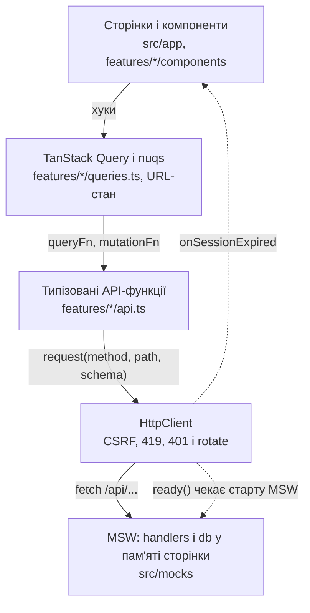
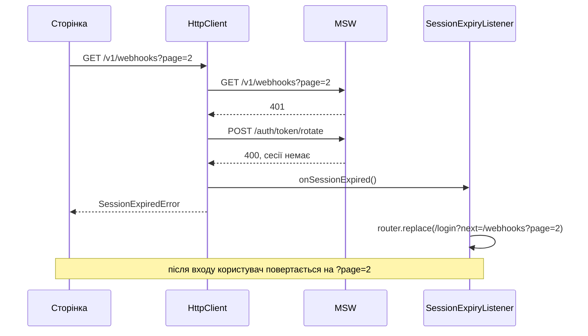

# Smart Sender: вебхуки

Тестове завдання Senior Frontend Engineer. Застосунок складається з входу із сесією, що ротується, списку вебхуків із пошуком і пагінацією в URL та сторінки редагування із серверною валідацією. Бекенд реалізовано моком на MSW за контрактом із завдання.

**Стек:** Next.js 16 (App Router), React 19, TypeScript (strict), TanStack Query 5, nuqs 2, react-hook-form + zod 4, shadcn/ui (Base UI), MSW 3, Vitest 5.

## Запуск

Потрібні Node.js 22.12+ і pnpm 11. Версію pnpm закріплено в `packageManager`, тож після `corepack enable` вона підтягнеться автоматично.

```bash
pnpm install --frozen-lockfile
pnpm dev
```

Застосунок відкривається на http://localhost:3000. Якщо порт зайнятий, запустіть `pnpm dev --port 3100`.

Тести:

```bash
pnpm test
```

| Скрипт                             | Що робить                                                  |
| ---------------------------------- | ---------------------------------------------------------- |
| `pnpm dev`                         | dev-сервер Next.js (Turbopack)                             |
| `pnpm build`, `pnpm start`         | продакшн-збірка і запуск                                   |
| `pnpm test`, `pnpm test:watch`     | Vitest: тести `HttpClient` проти справжніх handler-ів моку |
| `pnpm typecheck`                   | `next typegen` + `tsc --noEmit`                            |
| `pnpm lint`                        | ESLint                                                     |
| `pnpm format`, `pnpm format:check` | Prettier                                                   |

### Тестовий акаунт

| Поле   | Значення                |
| ------ | ----------------------- |
| Email  | `demo@smartsender.test` |
| Пароль | `Demo1234!`             |

Мок живе в пам'яті сторінки, тому після перезавантаження сесія зникає і треба увійти знову (умова завдання це дозволяє). Після входу застосунок повертає на ту саму адресу, тож параметри списку з URL застосовуються.

Мок працює через Service Worker, тому застосунок треба відкривати по `http://localhost` (або по HTTPS). Якщо Service Worker недоступний (наприклад, у приватному вікні Firefox), MSW сам переходить на перехоплення запитів на сторінці.

## Що реалізовано

- **Вхід.** Форма email і пароля. Далі `POST /auth/login` → `POST /auth/token/issue` → `GET /v1/me` → перехід до списку.
- **`device_session_token`** існує лише як локальна змінна всередині функції входу. Він не потрапляє ні в стан React, ні в кеш запитів, ні в storage, ні в URL.
- **`fingerprint`.** 32 hex-символи з `crypto.getRandomValues`, генерується один раз і зберігається в `localStorage`. Якщо значення пошкоджене, воно генерується наново.
- **Сесія на 30 секунд.**
  - На 401 виконується один спільний rotate на всі паралельні запити, після чого кожен запит повторюється один раз.
  - Невдалий rotate або повторний 401 ведуть на сторінку входу з поверненням на поточну адресу.
- **Вихід.** `POST /auth/token/revoke` і очищення локального стану й кешу запитів.
- **CSRF.**
  - Перед першим запитом виконується `GET /csrf`.
  - `X-Requested-With` надсилається завжди, `X-CSRF-TOKEN` — на POST і PUT.
  - На 419 застосунок отримує новий токен і повторює запит не більше одного разу.
- **Список вебхуків.**
  - Таблиця з назвою, URL і активністю, 10 записів на сторінку, пошук за назвою.
  - `page` і `search` зберігаються в URL і відновлюються після перезавантаження та переходів «назад» і «вперед». Зміна пошуку повертає на першу сторінку.
  - Є стани завантаження, порожнього результату, сторінки за межами списку та помилки.
- **Редагування** на сторінці `/webhooks/[id]`. Серверні 422 показуються біля відповідних полів, 404 — окремим станом.
- **Тест:** два паралельні 401 → один rotate → успішні повтори. Плюс ще два тести на найризиковіші гілки (див. [Тести](#тести)).

## Ключові рішення

### Next.js, але дані тільки на клієнті

Сесію за умовою зберігає мок (аналог HttpOnly-cookie), а handler-и MSW виконуються в браузері. Сервер Next.js цієї сесії не бачить, тому Server Components і `proxy`/middleware не можуть ні звертатися до API, ні захищати маршрути. Next.js тут відповідає за роутинг, layouts і статичні оболонки сторінок, а дані на клієнті вантажить TanStack Query. З реальним бекендом і cookie наступним кроком був би prefetch на сервері з `HydrationBoundary`.

Застосунок не тримає рендер, доки стартує MSW: Next 16 з `cacheComponents` очікує, що сегменти рендеряться на сервері. Натомість `HttpClient` має хук `ready()`, і кожен запит чекає, поки worker почне перехоплювати запити.



UI не викликає `fetch` напряму. Залежності йдуть лише згори вниз, а код застосунку звертається до `src/mocks` в одному місці: у `ready()` в [`src/lib/api/client.ts`](src/lib/api/client.ts).

### HttpClient: протокол сесії в одному місці

[`src/lib/api/http-client.ts`](src/lib/api/http-client.ts) приховує від решти коду CSRF, повтори і сесію. Компоненти отримують або типізовані дані, або `ApiError` / `SessionExpiredError`.

- **CSRF-токен.** Запитується один раз і кешується як Promise, тому паралельні перші запити чекають один `GET /csrf`. На 419 клієнт скидає саме той токен, з яким ішов запит, отримує новий і повторює запит один раз.
- **Спільний rotate.** На 401 усі одночасні запити чекають один і той самий Promise. Сам rotate іде з `auth: false`, тож не може запустити ще один rotate.
- **Epoch.** Лічильник сесії збільшується після кожного успішного rotate і після входу. Якщо 401 прийшов на запит, відправлений ще до завершення rotate, новий rotate не запускається: запит просто повторюється.
- **Завершення сесії.**
  - Невдалий rotate або повторний 401 завершують сесію і сповіщають слухачів.
  - Далі захищені запити падають одразу, без звернення до мережі, і теж сповіщають слухачів. Тому «назад» після виходу веде на сторінку входу, а не на порожню сторінку з помилками.
- **Перевірка відповідей.** Кожна відповідь проходить runtime-перевірку zod-схемою. TS-типи виводяться з тих самих схем.


### Сесія в інтерфейсі

- **Блокуючого guard немає.** Сторінки рендеряться одразу зі своїми станами завантаження, а доступ забезпечує API. Шапка вантажить `/v1/me` паралельно з даними сторінки. Обгортка, що не рендерить сторінку до відповіді `/v1/me`, суперечила б перевіркам instant navigation у Next 16.
- **[`SessionExpiryListener`](src/features/auth/components/session-expiry-listener.tsx)** перенаправляє на `/login?next=<поточний URL>`. Повідомлення «сесія закінчилась» з'являється, лише якщо користувач перед цим був у системі.
- **`?next=`** проходить через [`safeRedirectPath`](src/lib/routes.ts): розбирається через `URL` і пропускає лише шляхи свого origin. `//evil.com`, `/\evil.com` і `javascript:` відкидаються.
- **Activity.** З `cacheComponents` Next.js не розмонтовує сторінку при переході, а ховає її разом зі станом. Через це:
  - кеш запитів очищає сама сторінка входу, коли з'являється: прихована сторінка вже не підписана на запити, тож очищення не викликає зайвих повторних запитів;
  - форма входу скидається після успішного входу, щоб пароль не лишався в полі;
  - форма редагування після збереження приймає збережені значення як нову основу.
- **Пароль у кеші мутацій.** Змінні мутації входу містять пароль, тому мутація має `gcTime: 0` і видаляється одразу, щойно на неї ніхто не підписаний.



### Стан списку в URL

- **nuqs.** `page` і `search` читаються через [nuqs](src/features/webhooks/search-params.ts). Парсери беруться з `nuqs/server`, тож їх можна імпортувати і з серверних компонентів. Невалідний `page` (`abc`, `0`, `-1`) стає першою сторінкою, а значення за замовчуванням у URL не пишуться.
- **Пошук.** Поле оновлюється на кожну клавішу, а в URL значення потрапляє після 300 мс паузи. Зміни URL, що прийшли не з набору («назад», «Clear search»), переносяться в поле. Відлуння власного запису в URL розпізнається і не стирає те, що користувач устиг дописати ([`webhooks-search.tsx`](src/features/webhooks/components/webhooks-search.tsx)).
- **Пагінація** зроблена посиланнями `next/link`, тож кожна сторінка — окремий запис в історії. Поки вантажиться наступна сторінка, попередня лишається на екрані (`keepPreviousData`).
- **Редагування** відкривається з параметрами списку в адресі (`/webhooks/7?page=2&search=crm`). Посилання «назад» і перехід після збереження повертають ту саму сторінку і пошук.

### Форми і помилки

- **React Hook Form + zod.** [`applyServerErrors`](src/lib/forms.ts) розкладає 422 по полях і ставить фокус на перше поле з помилкою. Поля, яких у формі немає (наприклад, `captcha`), та інші помилки показуються над формою.
- **Розподіл валідації.** На клієнті форма редагування перевіряє лише обов'язкові поля, а формат URL перевіряє сервер. Так правила не дублюються і не розходяться, а серверну помилку легко побачити: введіть `ftp://example.com` у поле URL.
- **Після збереження** відповідь `PUT` записується в кеш деталі, а списки інвалідуються, бо нова назва може змінити результати пошуку.

### Типізація

- **TypeScript** працює в `strict` разом із `noUncheckedIndexedAccess`, `noImplicitOverride` і `noFallthroughCasesInSwitch`.
- **zod-схеми** — єдине джерело правди для форм контракту: з них виводяться типи, і вони ж перевіряють відповіді під час виконання.
- **`ApiError`** має тип помилки у вигляді union із таблиці контракту та поля `fieldErrors`. Type guards: `isApiError(error, status)` і `isValidationError(error)`.

## Структура

```
src/
  app/                    маршрути: layout, providers, /login, (app)/webhooks, (app)/webhooks/[id]
  components/             shadcn/ui (ui/), шапка, LoadError
  features/
    auth/                 API, схеми, запити й мутації, LoginForm, UserMenu, SessionExpiryListener
    webhooks/             API, схеми, запити, URL-параметри, таблиця, пошук, пагінація, форма
  lib/
    api/                  HttpClient, ApiError, налаштований apiClient, тест
    fingerprint.ts        стабільний ідентифікатор пристрою
    forms.ts              серверні помилки → поля форми
    query-client.ts       політика повторів TanStack Query
    routes.ts             маршрути і безпечний ?next=
  mocks/                  db у пам'яті, перевірки запиту, handlers, browser/node, enableMocking
```

## Мок API

- **Шляхи** з контракту обслуговуються з префіксом `/api` (наприклад, `/api/v1/webhooks`). Префікс задано одним рядком у [`src/lib/config.ts`](src/lib/config.ts). Мок вимикається через `NEXT_PUBLIC_API_MOCKING=disabled`.
- **Порядок перевірок** у кожному handler-і такий, як на бекенді: `X-Requested-With` (400) → CSRF на POST і PUT (419) → сесія (401) → ресурс (404) → валідація (422).
- **Рішення в місцях, які умова не уточнює:**
  - без заголовка `X-Requested-With` мок відповідає 400: так він перевіряє, що клієнт виконує контракт;
  - порожній `X-Captcha-Token` дає 422 з полем `captcha`; невідомий email — 422 з полем `email`; невірний пароль — 422 з полем `password`;
  - rotate працює і для протухлої сесії, доки її не відкликали через revoke, інакше сценарій «401 → rotate → повтор» був би неможливим. До `issue` і після `revoke` rotate повертає 400;
  - device token одноразовий і прив'язаний до fingerprint.
- **Дані:** один користувач і 28 вебхуків зі стабільним порядком.

## Тести

[`src/lib/api/http-client.test.ts`](src/lib/api/http-client.test.ts) запускає `HttpClient` проти тих самих handler-ів, що й браузер, через `msw/node`. Протухання сесії імітується через `vi.setSystemTime`: підмінено лише `Date`, справжні таймери не зачеплені.

1. **Обов'язковий.** Два паралельні запити отримують 401, rotate виконується рівно один раз, кожен запит іде двічі, обидва повертають валідні дані.
2. **Невдалий rotate.** Обидва запити падають із `SessionExpiredError`. Наступний захищений запит відхиляється без мережевого виклику, але теж сповіщає слухача.
3. **419.** CSRF-токен запитується заново один раз, а PUT повторюється і завершується успішно.

## Обмеження і що далі

- **Перезавантаження скидає мок**, тож сесія після reload не переживає (умова це дозволяє). З реальним бекендом клієнт уже готовий: на старті він перевіряє сесію через `/v1/me` і rotate.
- **Тестів компонентів і e2e немає.** Наступним кроком був би Playwright зі сценаріями з розділу «Що реалізовано».
- **`?page=abc`** показує першу сторінку, але сам URL не виправляється.
- **Без продуктових доповнень:** немає оптимістичних оновлень, попередження про незбережені зміни та i18n. Інтерфейс англійською.
- **Під реальний бекенд** треба буде:
  - підключити справжню капчу в [`getCaptchaToken`](src/features/auth/captcha.ts);
  - прибрати хук `ready()`;
  - додати prefetch на сервері, коли сесія буде в cookie.
